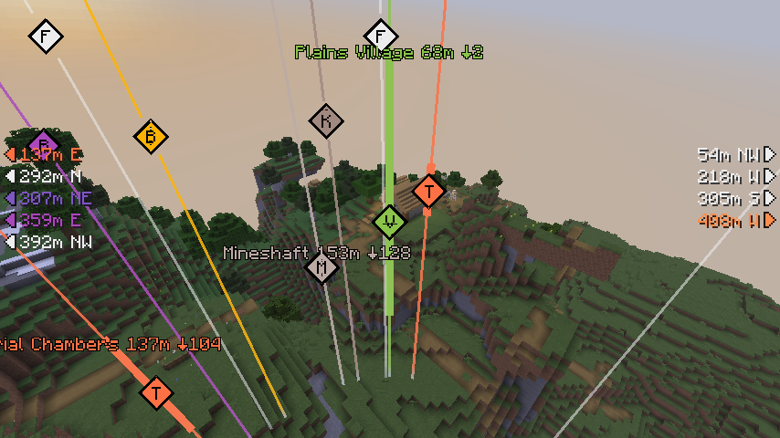
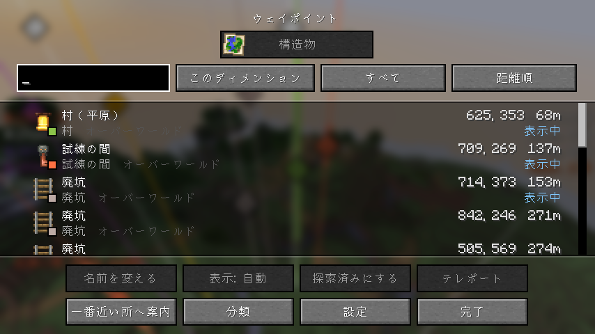
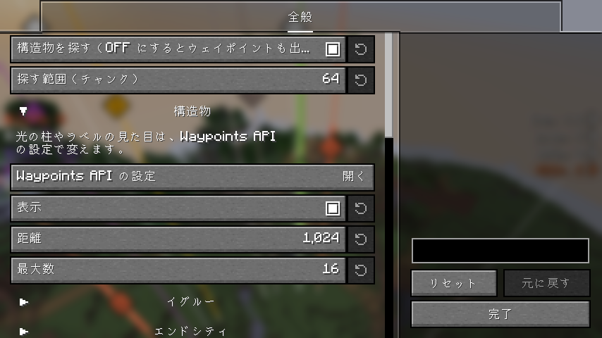

# Structure Waypoints

[English](README.md) | 日本語

ワールドのシードから構造物の場所を計算し、Waypoints API でウェイポイントとして表示する Fabric 向けクライアント MOD です。
クライアントに入れるだけで動作し、バニラサーバーでも使えます（サーバー側への導入は不要です）。

## 機能

### シードからの構造物の計算

ゲーム本体のワールド生成のコードで、シードから構造物の場所を計算します。探検して見つける必要はなく、チャンクが読み込まれていなくても分かります。

- **構造物**: 村、ピリジャーの前哨基地、森の洋館、砂漠・ジャングルの寺院、魔女の小屋、イグルー、海底神殿、海底遺跡、難破船、埋もれた宝、荒廃したポータル、廃坑、要塞、古代都市、旅路の遺跡、試練の間、放棄されたキャンプ、ネザー要塞・砦の遺跡、ネザーの化石、エンドシティ。
- **すべてのディメンション**: オーバーワールド・ネザー・エンドを、行かなくても、いる所のまわりで計算します（ネザーはゲームと同じく座標の 1/8）。
- **探す範囲**: まわり 8〜128 チャンク（初期値は 64）。近いものから先に計算します。
- **シード**: シングルプレイと LAN に開いたワールドでは、入った時点で分かります。サーバーでは `/setseed <シード>` で入力するか、サーバーが許していればバニラの `/seed` を実行します。シードはサーバーごとに覚えます。
- **データ**: シングルプレイではワールド自身のデータ（データパックを含む）を使います。サーバーではバニラのデータを使い、ワールドの種類（デフォルト・大きなバイオーム・Amplified）は地形から割り出します。シードが届いた地形と合わないあいだは何も表示しません。構造物の置き方を変えているサーバーでは、場所が違うことがあります。

### ウェイポイント

構造物の表示は、この MOD の jar に入っている [Waypoints API](https://github.com/LivingDeadDolls/WaypointsAPI) が行います。

- **ワールドの中**: 構造物の種類ごとの色の光の柱、頭文字つきのひし形、名前・距離・上下の差を出すラベル。見えていない構造物は、画面の端に矢印と距離・方角を出します。
- **探索済み**: 構造物の中に入ると探索済みになり、隠すこともできます。
- **一覧**: すべての構造物を 1 つの一覧に並べます。検索・絞り込み・並び替え・名前の変更・ピン留め・テレポート（コマンドを使える人だけ）・一番近い所への案内ができます。
- **地図の MOD**: JourneyMap と Xaero's World Map に出せます。一覧から Xaero's Minimap と VoxelMap のウェイポイントにも足せます。

## 設定

設定画面は [Mod Menu](https://modrinth.com/mod/modmenu) から開きます。

- **構造物を探す**: OFF にすると計算をやめ、ウェイポイントも表示しません（消えはしません）。
- **探す範囲**: 自分から何チャンク先まで構造物を探すか。
- **構造物**: 表示するか、表示する距離（初期値は 1,024 ブロック）、同時に表示する数（初期値は 16）。構造物の種類ごとに、表示するか・色・一番近い 1 つだけ表示するか。廃坑・埋もれた宝・難破船・海底遺跡・荒廃したポータルは、初期状態で一番近い 1 つだけを表示します。

光の柱・ラベル・矢印の見た目は、Waypoints API の設定で変えます。Mod Menu では、この MOD が Waypoints API の下に並びます。キー（一覧を開く、ウェイポイントの表示の切り替え）は Waypoints API のもので、初期状態では割り当てがありません。操作設定の「Waypoints API」で割り当ててください。

## 必要なもの

- [Fabric API](https://modrinth.com/mod/fabric-api)
- [YetAnotherConfigLib](https://modrinth.com/mod/yacl)
- [Mod Menu](https://modrinth.com/mod/modmenu)（任意。設定画面を開くのに使います）

[Seed Engine API](https://github.com/LivingDeadDolls/SeedEngineAPI) と Waypoints API は jar に入っているので、ほかに入れるものはありません。
対応する Minecraft のバージョンは各リリースに記載しています。

## 注意

構造物の場所が分かることを有利と見なして、ルールで禁止しているサーバーがあります。
使用はサーバーのルールに従ってください。
