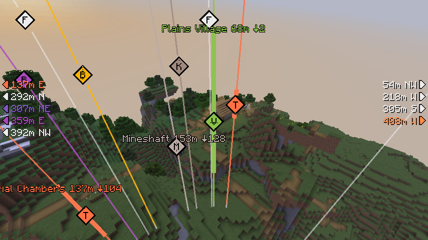
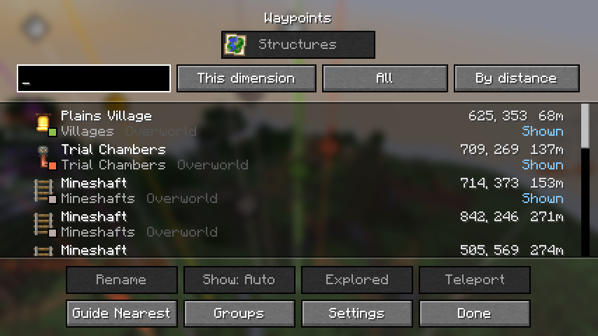
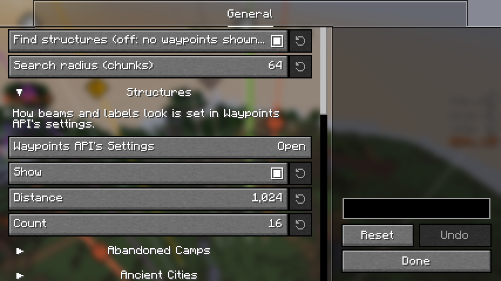

# Structure Waypoints

English | [日本語](README.ja.md)

A client-side Fabric mod that works out where structures are from the world's seed and shows them as waypoints through Waypoints API.
Just install it on your client; it also works on vanilla servers (nothing needs to be installed on the server).

## Features

### Structures from the seed

The structures are worked out from the seed with the game's own world generation, so you do not have to explore to find them and the chunks need not be loaded.

- **Structures**: villages, pillager outposts, woodland mansions, desert and jungle pyramids, swamp huts, igloos, ocean monuments and ruins, shipwrecks, buried treasures, ruined portals, mineshafts, strongholds, ancient cities, trail ruins, trial chambers, abandoned camps, nether fortresses and bastions, nether fossils and end cities.
- **Every dimension**: the Overworld, the Nether and the End are worked out around where you are, without going there first (the Nether at 1/8 of the coordinates, as in the game).
- **Search radius**: 8 to 128 chunks around you (64 at first). The nearest are worked out first.
- **The seed**: in singleplayer, and in a world opened to LAN, it is known as soon as you join. On a server, enter it with `/setseed <seed>` or run the vanilla `/seed` if the server lets you. The seed is remembered for each server.
- **Data**: singleplayer uses the world's own data, data packs included. On a server, the vanilla data is used and the world type (Default, Large Biomes, Amplified) is worked out from the terrain; nothing is shown while the seed does not fit the terrain you were sent. A server that changes where structures are placed may show different places.

### Waypoints

The structures are shown by [Waypoints API](https://github.com/LivingDeadDolls/WaypointsAPI), which is included in this mod's jar.

- **In the world**: a beam in each kind of structure's color, a diamond with its initial, and a label with the name, the distance and how far above or below it is. Structures out of sight point from the screen's edges with their distance and direction.
- **Explored**: a structure is marked explored when you enter it, and can be hidden then.
- **The list**: every structure in one list, with search, filters, sorting, renaming, pinning, teleporting (when you may run commands) and a guide to the nearest.
- **Map mods**: on JourneyMap and Xaero's World Map, and from the list to the waypoints of Xaero's Minimap and VoxelMap.

## Settings

The settings screen is opened from [Mod Menu](https://modrinth.com/mod/modmenu).

- **Find structures**: off stops working them out and hides their waypoints (they are kept).
- **Search radius**: how far around you structures are looked for.
- **Structures**: whether to show them, the distance up to which they are shown (1,024 blocks at first), and how many are shown at a time (16 at first). For each kind of structure: whether to show it, its color, and whether to show only the nearest one. Mineshafts, buried treasures, shipwrecks, ocean ruins and ruined portals show only the nearest at first.

How beams, labels and arrows look is set in Waypoints API's settings, which Mod Menu lists with this mod below it. Keys (open the list, show/hide waypoints) belong to Waypoints API and are unbound at first. Bind them under "Waypoints API" in the Controls settings.

## Requirements

- [Fabric API](https://modrinth.com/mod/fabric-api)
- [YetAnotherConfigLib](https://modrinth.com/mod/yacl)
- [Mod Menu](https://modrinth.com/mod/modmenu) (optional, for opening the settings screen)

[Seed Engine API](https://github.com/LivingDeadDolls/SeedEngineAPI) and Waypoints API are included in the jar; there is nothing more to install.
The supported Minecraft versions are listed on each release.

## Note

Knowing where structures are is an advantage that some servers do not allow by their rules.
Follow the rules of the server you play on.
